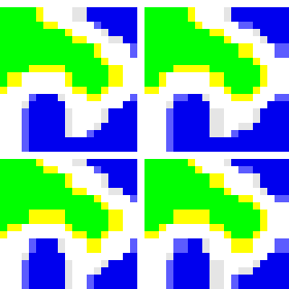
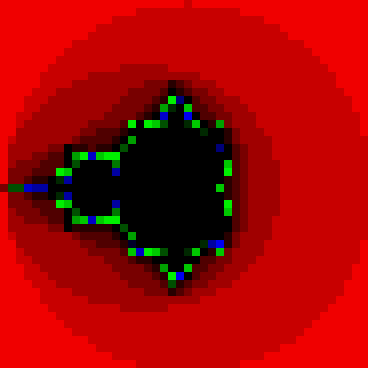
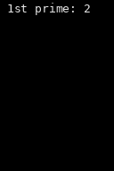
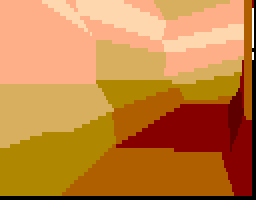

# Multi-cycle RV32I SoC on the Digilent Genesys 2

Undergraduate project by Amit Malach, supervised by Prof. Avi Mendelson, Technion.

## Purpose

A complete small computer, built to be understood from the gates up: a multi-cycle RV32I core
in plain Verilog-2001, 6 KB of block RAM, an LED register, a UART transmitter and an SPI-flash
controller that runs programs in place from the board's flash. It targets the Digilent
Genesys 2 (Kintex-7 `xc7k325tffg900-2`, 200 MHz), boots from the RAM or from the flash, and
runs demos in C and assembly, from a blinker to a ray tracer. It is not a performance design.

## Repository layout

| Path | Contents |
|---|---|
| `rtl/` | Synthesizable Verilog, one module per file, `SOC.v` the top; `defines.vh`, the memory map; `firmware.hex`, the one firmware image |
| `fw/` | Demo programs, start-up code, linker scripts and the image converters |
| `sim/` | SoC testbench with its golden trace, ALU unit bench |
| `constraints/` | Pins and the 200 MHz clock |
| `vivado/` | Tcl scripts: project, bitstream, JTAG load, flash read and write |
| `docs/` | Final report, design notes, baseline numbers, demo animations |
| `scripts/` | Lint and git hooks |
| `build/` | Everything generated: Vivado project, `SOC.bit`, gate logs. Not tracked |

Each tracked folder has a README listing its files and the make targets that serve it.

## Building the firmware

Needs `riscv64-unknown-elf-gcc`; a flash build also needs Vivado's `settings64.sh` sourced.

```sh
make -C fw                              # mandelbrot, BRAM boot: rewrites rtl/firmware.hex
make -C fw PROG=<demo>                  # another demo, BRAM boot
make -C fw PROG=<demo> TARGET=flash     # flash boot: fw/build/<demo>.spiflash.mcs
```

The committed image is always mandelbrot and reproduces with GCC 13.2.0. Other targets and
variables: `fw/README.md`.

| Demo | Output |
|---|---|
| `blinker` | LED pattern |
| `sieve` | Prime numbers on the UART |
| `mandelbrot` | Mandelbrot set in ANSI colour on the UART, frame counter on the LEDs |
| `riscv_logo` | Rotating RISC-V logo on the UART |
| `ST_NICCC` | The ST-NICCC polygon demo in ANSI characters |
| `tinyraytracer` | Ray-traced scene on the UART; flash boot only (29 KB of code) |

## Building the bitstream

```sh
source <vivado-install>/settings64.sh   # Vivado 2025.2
make bitstream                          # build/SOC.bit; prints WNS, WHS and timing=MET|FAILED
```

This builds the flash-boot design and leaves the project, `build/vivado/soc.xpr`, for the GUI.
BRAM-boot bitstreams are built per demo, below. Other Vivado targets: `vivado/README.md`.

## Running the demos

Open a serial terminal on the board's USB-UART port, 115200 baud, 8N1. The demos end lines
with a bare LF and draw with ANSI 16-, 256- and 24-bit colour codes:

```sh
picocom -b 115200 --imap lfcrlf /dev/ttyUSB0
```

Each animation is rendered from a UART capture of the board.



`riscv_logo`, BRAM boot: one turn of 64 frames, in real time.



`mandelbrot`, BRAM boot: 23 frames, about a second each. Frame 0 is byte for byte the golden
trace's UART output.


`tinyraytracer`, flash boot: 20 times faster than the board's 127 s.



`sieve`, BRAM boot: the first two rounds, 50 times slower than the board.



`ST_NICCC`, BRAM boot: the screen every half second, in real time, from 70 s into the run.

Both boot modes load the bitstream over JTAG. It lasts until power-off; the board then boots
whatever the flash holds at offset `0x0`, which nothing here writes. Run the commands from the
repository root with Vivado's `settings64.sh` sourced.

### BRAM boot

The program is part of the bitstream, so each demo is a rebuild (`tinyraytracer` does not
fit):

```sh
mkdir -p build/board/<demo>
make -C fw PROG=<demo> HEX_OUT=$PWD/build/board/<demo>/firmware.hex
cd build/board/<demo>
vivado -mode batch -nojournal -nolog -source ../../../vivado/board_bitstream.tcl -tclargs . bram
vivado -mode batch -nojournal -nolog -source ../../../vivado/board_program.tcl -tclargs SOC.bit
cd -
```

The core starts when the load ends; press the reset button to see the demo from its start.

### Flash boot

1. `make -C fw PROG=<demo> TARGET=flash` places the code at flash offset `0xD00000`.
2. Write it to the flash:

   ```sh
   mkdir -p build/board && cd build/board
   vivado -mode batch -nojournal -nolog -source ../../vivado/board_flash.tcl \
       -tclargs write ../../fw/build/<demo>.spiflash.mcs
   cd -
   ```

   Only the bytes the image covers change, and the flash's Quad Enable bit is kept
   (`vivado/README.md`, "The Quad Enable bit").
3. Build the flash-boot bitstream and load it:

   ```sh
   make bitstream
   cd build/board
   vivado -mode batch -nojournal -nolog -source ../../vivado/board_program.tcl -tclargs ../SOC.bit
   cd -
   ```

4. Press the reset button once the load has ended: straight after configuration the core's first
   flash fetch is most likely lost (`docs/design/notes.md`, "Flash boot loses its first fetch").

`ST_NICCC`, in either boot mode, also needs its 625 KB scene file, `scene1.dat` (not in this
repository), at flash offset `0xC00000`: wrap it with `fw/tools/write_mcs.tcl` and write it as
in step 2.

A board as shipped holds factory data that the scene data and the code partly overwrite. Back
the whole flash up before the first write: step 2 with `-tclargs read 0x0 0x2000000 <file>.bin`
(about two minutes). To restore, wrap the slice from `0xC00000` with `fw/tools/write_mcs.tcl`
and write it as in step 2.

## Simulation and checks

```sh
make lint
make smoke
make -j2 check
```

The root `Makefile`'s header lists every gate, the tools it needs and how long it takes;
`sim/README.md` describes the golden-trace regression.

## Final report

[`docs/design/design.pdf`](docs/design/design.pdf): the design choices and how the core, memory,
SoC and firmware fit together. [`docs/design/notes.md`](docs/design/notes.md): the reasoning
behind each module, one question at a time; the report cites it by title.

## Results

All six demos run on the board. The design meets timing at 200 MHz and uses under 0.5 % of the
device's LUTs, flip-flops and block RAM: `docs/baseline.md` holds the numbers, the report's
chapter "Implementation results" analyses them.

## License

BSD-3-Clause, except `rtl/UartTx.v`, which stays under Apache-2.0; see `LICENSE`.
